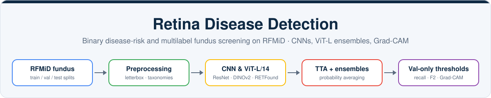
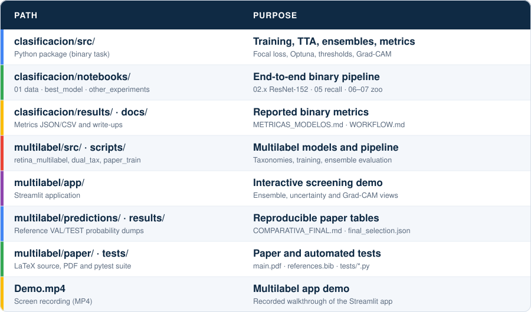

<p align="center"></p>

<p align="center">
  
  
  
  
  
  
</p>

# Retina Disease Detection

**Author:** Xabat Arin Mendizabal

Deep-learning screening of retinal fundus photographs from the **RFMiD** dataset, organised as two complementary research projects. [`clasificacion/`](clasificacion/) predicts the binary `Disease_Risk` label with ResNet-152 and a small CNN zoo, prioritising **recall** (few missed patients) through TTA, ensembles and validation-tuned thresholds. [`multilabel/`](multilabel/) goes further and predicts several diseases at once under three label taxonomies (ODIR-7, Cluster-C, Sup-K12) with **ViT-L/14** models initialised from DINOv2 / RETFound, and ships a Streamlit demo with Grad-CAM. In both projects the test split is used only for the final report: epochs, ensemble members and thresholds are always chosen on validation.

> **Not a medical device** — research code only.

[Watch the multilabel app demo](Demo.mp4) (MP4).

## How it works

1. **Data** — RFMiD fundus images and labels (train / validation / test). Images are not stored in Git.
2. **Preprocessing** — *binary:* letterbox resize (no random crop) to keep the whole fundus; *multilabel:* the original RFMiD labels are grouped into the ODIR-7, Cluster-C and Sup-K12 taxonomies.
3. **Training**
   - *Binary:* ResNet-152 with focal loss and hyper-parameters found with Optuna (TPE, validation AUC), followed by recall-focused fine-tuning (hard-example re-weighting) and a zoo of ResNet-50, DenseNet-121, EfficientNet-B0 and ConvNeXt-Tiny.
   - *Multilabel:* ViT-L/14 with residual attention pooling (DINOv2 or RETFound initialisation, 392/518 px), plus BFPC, Inception and autoencoder baselines for comparison.
4. **Inference** — test-time augmentation (identity, horizontal flip, ±10°) and equal-weight probability averaging across ensemble members.
5. **Operating point** — thresholds fixed on validation: target recall / *FN < FP* with bootstrap (binary) or per-label F₂ maximisation (multilabel). Confidence intervals come from bootstrap resampling of the test images.
6. **Explainability** — Grad-CAM maps for both projects and an interactive Streamlit app for the deployed ODIR-7 ensemble.

## Results


All numbers are on the 640-image RFMiD test split, with model selection and thresholds fixed on validation. Multilabel metrics are macro averages; the F₂ confidence interval uses 2,000 bootstrap resamples.

**Binary `Disease_Risk` — single models with TTA (threshold *FN < FP*, chosen on validation)**

| Model | AUC | Recall | Specificity | F1 |
|---|---:|---:|---:|---:|
| ResNet-152 tuned (05) | 0.968 | 0.947 | 0.806 | 0.948 |
| DenseNet-121 (07) | 0.967 | 0.951 | 0.806 | 0.950 |
| ConvNeXt-Tiny (07) | 0.958 | 0.947 | 0.821 | 0.950 |
| EfficientNet-B0 (07) | 0.951 | 0.939 | 0.791 | 0.942 |
| ResNet-50 (07) | 0.947 | 0.943 | 0.746 | 0.938 |

**Multilabel ODIR-7 — deployed ensemble members**

| Model | Recall | Precision | F2 [95% CI] | AUROC | mAP |
|---|---:|---:|---:|---:|---:|
| ViT-RA v2 518 (DINOv2) | 0.893 | 0.595 | 0.812 [0.792, 0.830] | 0.940 | 0.817 |
| ViT-RA v2 (DINOv2) | 0.904 | 0.582 | 0.814 [0.794, 0.831] | 0.940 | 0.815 |
| ViT-RA v3 (RETFound) | 0.853 | 0.601 | 0.787 [0.764, 0.809] | 0.931 | 0.814 |
| **3-model ensemble** | **0.913** | **0.622** | **0.835 [0.817, 0.852]** | **0.954** | **0.849** |

Full tables: [`clasificacion/docs/METRICAS_MODELOS.md`](clasificacion/docs/METRICAS_MODELOS.md) and [`multilabel/results/COMPARATIVA_FINAL.md`](multilabel/results/COMPARATIVA_FINAL.md). Reports: [`clasificacion/Retina_clasificacion.pdf`](clasificacion/Retina_clasificacion.pdf) and [`multilabel/paper/main.pdf`](multilabel/paper/main.pdf).

## Repository structure



Each project has its own guide: [`clasificacion/README.md`](clasificacion/README.md) (with [`docs/WORKFLOW.md`](clasificacion/docs/WORKFLOW.md)) and [`multilabel/README.md`](multilabel/README.md).

## Getting started

**Data.** Download RFMiD from [IEEE DataPort](https://ieee-dataport.org/open-access/retinal-fundus-multi-disease-image-dataset-rfmid) (CC BY 4.0) or with [`multilabel/notebooks/00_download_data.ipynb`](multilabel/notebooks/00_download_data.ipynb). The dataset root must contain `Training_Set/`, `Evaluation_Set/` and `Test_Set/`.

**Binary classification** — place the RFMiD folders inside `clasificacion/` or its parent directory (auto-detected by `src/config.py`):

```bash
cd clasificacion
pip install -r requirements.txt
python scripts/check_notebooks.py     # quick sanity check, no training
jupyter lab notebooks/                # run 01_data -> best_model/02.x -> 05 -> 06
```

**Multilabel classification** — reproduce the paper tables without GPU or images, using the shipped prediction dumps:

```bash
cd multilabel
pip install -r requirements.txt
pip install -e ".[app]"
pytest
python scripts/03_evaluate_ensembles.py --pred-dir predictions/reference
```

To retrain, set `RETINA_DATA_ROOT=/path/to/RFMiD` and run `python scripts/02_train.py configs/vit_residual_attn_odir7_v2_518.yaml`. To launch the demo, download the three ODIR-7 checkpoints from [Hugging Face](https://huggingface.co/XabatarinAI/Modelos_retina_multilabel) into `multilabel/checkpoints/final_20261030/` and run `streamlit run app/app.py`. Step-by-step instructions are in [`multilabel/README.md`](multilabel/README.md).

## Future work

- **External validation:** evaluate both systems on an independent fundus dataset (other cameras and populations) to measure generalisation beyond RFMiD.
- **Probability calibration:** apply temperature scaling on validation and report Brier score, ECE and reliability diagrams, so that scores can be read as risk.
- **Better precision at high recall:** the multilabel ensemble keeps recall at 0.913 but precision at 0.622; explore per-label cost-sensitive or Pareto operating points, especially for glaucoma and AMD.
- **Joint binary + multilabel model:** share one ViT backbone with a `Disease_Risk` head and a multilabel head instead of two separate pipelines.
- **Lighter deployment:** distil the ViT-L/14 ensemble (~1.16 GB per checkpoint) into a smaller model and benchmark CPU inference latency for the app.
- **Uncertainty and image quality:** flag low-quality or out-of-distribution images and defer them to a human grader instead of predicting.

## License

The code is released under the [MIT License](LICENSE) (the multilabel project also includes its own [MIT licence](multilabel/LICENSE)). RFMiD images and labels are **CC BY 4.0** and are not redistributed here. RETFound-based weights carry a **CC BY-NC 4.0** non-commercial restriction, which the deployed ODIR-7 ensemble inherits.
